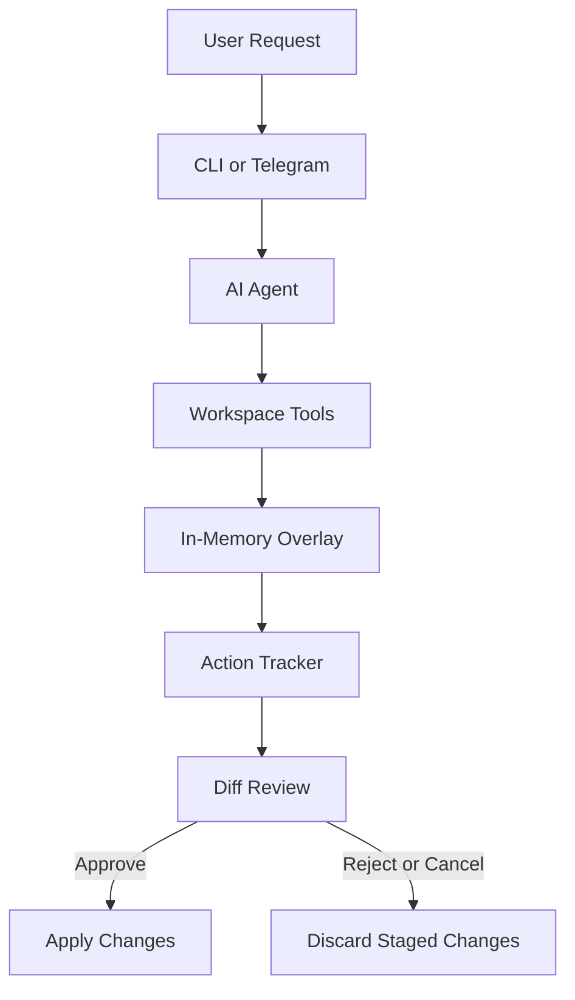

# devagent — AI Coding Assistant

devagent is a TypeScript-based AI coding assistant built with Bun and the Vercel AI SDK. It can explore a codebase, answer questions about existing code, plan changes, and assist with implementation through an interactive terminal interface or a Telegram bot.

Instead of writing every proposed change directly to disk, devagent stages file changes in memory and lets the user review diffs before applying them.

It supports three working modes:

- **Agent Mode:** Investigates tasks and proposes code changes through a multi-step tool loop.
- **Ask Mode:** Answers questions about the codebase without modifying project files, with an option to export answers to Markdown.
- **Plan Mode:** Breaks a task into structured steps and lets the user choose which steps to execute.

The project focuses on making AI-assisted development easier to inspect and control, especially when working with existing code.

## Tech Stack

| Component                   | Technology                   |
| --------------------------- | ---------------------------- |
| Runtime and package manager | Bun                          |
| Language                    | TypeScript                   |
| AI integration              | Vercel AI SDK                |
| Model provider              | OpenRouter                   |
| Schema validation           | Zod                          |
| Terminal interface          | Clack Prompts, Chalk, Figlet |
| Markdown rendering          | Marked, marked-terminal      |
| Diff generation             | diff (jsdiff)                |
| Web research                | Firecrawl, native `fetch`    |
| Telegram integration        | Telegraf                     |

## Getting Started

### Prerequisites

- [Bun](https://bun.sh/) installed on your system.
- An [OpenRouter](https://openrouter.ai/) API key.
- Internet access for model inference and optional web research.
- A Telegram bot token and owner ID if you want to use Telegram Mode.

### Installation

Clone the repository and install its dependencies:

```bash
git clone <repository-url>
cd devagent
bun install
```

Replace `<repository-url>` with the actual Git repository URL.

### Environment Configuration

Create a `.env` file in the project root:

```env
OPENROUTER_API_KEY=your_openrouter_api_key
OPENROUTER_DEFAULT_MODEL=your_supported_model_id

# Optional: web research
FIRECRAWL_API_KEY=your_firecrawl_api_key

# Optional: Telegram integration
TELEGRAM_BOT_TOKEN=your_telegram_bot_token
TELEGRAM_OWNER_ID=your_telegram_user_id

# Optional: custom skill directories
SKILLS_DIRS=./skills;D:/my-skills
```

| Variable                   | Purpose                                            | Where to get it                                   |
| -------------------------- | -------------------------------------------------- | ------------------------------------------------- |
| `OPENROUTER_API_KEY`       | Authenticates requests to OpenRouter               | [OpenRouter API Keys](https://openrouter.ai/keys) |
| `OPENROUTER_DEFAULT_MODEL` | Selects the model used by the application          | [OpenRouter Models](https://openrouter.ai/models) |
| `FIRECRAWL_API_KEY`        | Enables supported web search and crawling features | [Firecrawl](https://www.firecrawl.dev/)           |
| `TELEGRAM_BOT_TOKEN`       | Connects the Telegram bot                          | [Telegram BotFather](https://t.me/BotFather)      |
| `TELEGRAM_OWNER_ID`        | Restricts bot access to the configured owner       | [Telegram user ID bot](https://t.me/userinfobot)  |
| `SKILLS_DIRS`              | Provides additional skill directory paths          | Local filesystem                                  |

OpenRouter model IDs must correspond to models available to your account and supported by the configured SDK integration. Firecrawl and Telegram credentials are optional unless their respective features are used.

**Keep credentials private.** Ensure `.env` is ignored by Git and never commit real API keys, bot tokens, or other secrets.

### Run devagent

Start the application using its CLI entry point:

```bash
bun run index.ts wakeup
```

Choose the CLI interface and then select Agent, Ask, or Plan Mode. Select Telegram Mode if you want to start the remote bot and have configured its credentials.

### Useful Commands

```bash
# Install dependencies
bun install

# Start the application
bun run index.ts wakeup OR
devagent wakeup

# Run the project's type-check script
bun run typecheck

# Format source files, if configured in package.json
bun fmt
```

You can also run Bun's TypeScript checker directly:

```bash
bun check
```

Use the scripts defined in `package.json` as the source of truth for the commands supported by your checkout.

## How It Works

devagent uses an in-memory overlay to separate proposed file changes from the files currently on disk.



### Change Staging

When the agent proposes an edit, `ToolExecutor` stores the updated content in an in-memory `Map<string, string>`. Proposed deletions are tracked separately in a `Set<string>`.

Reads of staged files use the effective in-memory version, allowing the agent to work with its proposed changes before they are applied.

The `ActionTracker` records pending operations, including file modifications, creations, and deletions. The application can generate unified diffs so the user can inspect the proposed changes.

A simplified example of the modification workflow:

```typescript
modifyFile(rel: string, content: string): string {
  if (!this.config.tools.allowFileModification) {
    throw new Error("File modification disabled");
  }

  this.assertNotExcluded(rel, "modify_file");

  const before = this.getEffectiveText(rel);

  if (before === undefined) {
    throw new Error(`modify_file: file not found: ${rel}`);
  }

  const key = this.norm(rel);
  this.overlay.set(key, content);

  this.tracker.log({
    type: "file_modify",
    path: key,
    details: { before, after: content },
    status: "pending",
  });

  return `Staged update: ${key}`;
}
```

This illustrates the staging approach. Actual application behavior depends on the executor's configuration and approval workflow.

## Operating Modes

### 1. Agent Mode

Agent Mode handles multi-step development tasks such as investigating bugs, modifying existing files, creating new files, and assisting with refactoring.

Its tools include:

- `read_file` and `modify_file`
- `delete_file` and `create_folder`
- `list_files` and `search_files`
- `analyze_codebase`
- `execute_shell`
- `list_skills` and `read_skill`

The agent uses the Vercel AI SDK tool loop to decide which tools to call as it works toward a task. The configured loop allows up to 40 steps.

Proposed file changes are staged and presented for review. Depending on the selected workflow, the user can approve all changes, review them individually, or cancel.

**Example**

```text
Choose mode: Agent

Task:
Fix the date formatting bug in utils.ts.

Agent:
- Inspects the relevant files
- Identifies the formatting logic
- Proposes an updated implementation
- Stages the changes

Review:
- Inspect the unified diff
- Approve the changes
- Reject or cancel
```

Shell commands require special care: diff approval for file changes should not be treated as a sandbox for arbitrary command execution.

### 2. Ask Mode

Ask Mode is intended for understanding a codebase without making ordinary project modifications.

It supports questions about:

- Function and class responsibilities
- Module relationships and application architecture
- Existing implementation details
- Dependencies and relevant source files
- Supported web research workflows

File modification, folder creation, and shell execution are disabled in this mode according to its configured permissions.

Ask Mode also supports exporting a question and answer to a Markdown file, such as `ask.md`. This is a separate file-creation capability, not permission to edit arbitrary project files.

A simplified example of the filename validation:

```typescript
const filename = (value ?? "").trim();

if (!filename) {
  throw new Error("Filename is required");
}

if (
  filename.includes("..") ||
  filename.includes("/") ||
  filename.includes("\\")
) {
  throw new Error("Filename must not contain paths");
}

if (!filename.toLowerCase().endsWith(".md")) {
  throw new Error("Filename must end with .md");
}
```

The implementation validates the filename before creating the export. The actual export workflow also handles user cancellation.

**Example**

```text
Choose mode: Ask

Question:
How does the workspace path validation work?

devagent:
Explains the relevant implementation and its limitations.

Save answer to Markdown?
Yes

Filename:
ask.md
```

### 3. Plan Mode

Plan Mode separates task analysis from implementation.

**Phase 1 — Planning**

The planner uses read-only codebase tools and optional web research to prepare a structured plan. Zod validates the generated output against a schema.

A plan contains a research summary when available and between 1 and 15 steps. Each step can include a title, description, hints, and a complexity level.

```typescript
const planSchema = z.object({
  researchSummary: z.string().optional(),
  steps: z.array(
    z.object({
      title: z.string(),
      description: z.string(),
      hints: z.array(z.string()).optional(),
      complexity: z
        .enum(["low", "medium", "high"])
        .optional(),
    })
  ).min(1).max(15),
});
```

**Phase 2 — Selective Execution**

The user reviews the proposed steps and selects which ones to execute. Each selected step is passed to an execution agent with the relevant tools and staging workflow.

The resulting file changes can then be reviewed before being applied.

**Example**

```text
Goal:
Add token usage tracking to the AI configuration.

Proposed plan:
1. Inspect the model provider configuration.
2. Identify the available usage metadata.
3. Implement usage tracking.
4. Verify the resulting changes.

Select steps to execute.
Review the proposed changes before applying them.
```

Plan Mode helps organize larger tasks, but the quality of its plan and implementation still depends on the model, the available context, and the verification performed.

## Telegram Mode

Telegram Mode provides a remote interface for interacting with devagent.

After configuring the bot token and owner ID, the supported commands include:

| Command           | Purpose                                                    |
| ----------------- | ---------------------------------------------------------- |
| `/ask <question>` | Ask questions about the codebase and supported web sources |
| `/agent <task>`   | Run a coding task and review its proposed changes          |
| `/plan <goal>`    | Generate a plan and select steps for execution             |

The bot uses inline keyboard controls for supported approval and plan-selection workflows. Agent sessions can provide options such as accepting changes, rejecting changes, and viewing diffs.

Owner authorization is implemented through the configured `TELEGRAM_OWNER_ID`. Unauthorized requests should be rejected or ignored by the bot's authorization checks.

Treat the Telegram token as a secret. Owner checks are an access-control measure, not a replacement for secure session handling, safe command execution, or protection of the host machine.

## Security and Limitations

Security is an important part of devagent's design, but staged changes and path checks do not make every operation risk-free.

| Area                 | Current design or limitation                                                                                                                 |
| -------------------- | -------------------------------------------------------------------------------------------------------------------------------------------- |
| Path traversal       | `resolveSafe()` checks whether paths escape the configured workspace.                                                                        |
| Sensitive files      | `assertNotExcluded()` blocks configured exclusions such as `.env` files, `.git`, `node_modules`, build directories, and log files.           |
| Large files          | File reads have a configurable size limit, documented as 1 MB by default.                                                                    |
| Staged modifications | Proposed changes are kept in memory until the approval workflow applies them.                                                                |
| Human review         | CLI and supported Telegram workflows provide change-review controls.                                                                         |
| Telegram access      | Owner authorization checks the configured Telegram identity.                                                                                 |
| Shell execution      | Commands run through `spawnSync` with `shell: true`; command allowlisting or OS-level sandboxing is not implemented in the described design. |
| Symlinks             | Lexical path validation alone does not prevent a path from reaching outside the workspace through a symlink.                                 |
| Prompt injection     | Content from files and external web sources may contain malicious instructions that influence the model.                                     |

### Important Security Considerations

- **Shell commands:** Review commands before running them. Consider an explicit command allowlist or a restricted container for untrusted tasks.
- **Symlinks:** Resolve and validate canonical filesystem paths, including relevant parent directories, before file access or modification.
- **Prompt injection:** Treat file contents and web results as untrusted data. Clearly separate them from system instructions and validate proposed actions independently.
- **Sensitive files:** Review the exclusion rules and ensure they cover credentials and other project-specific secrets.
- **File application:** Consider failure recovery and rollback when applying multiple staged changes. Sequential file writes are not necessarily an atomic transaction.
- **API credentials:** Keep secrets out of source control, logs, model prompts, and exported reports.

These safeguards should be assessed against the actual implementation before devagent is used on sensitive repositories or production systems.

## Project Structure

```text
devagent/
├── ai/
│   ├── ai.config.ts
│   └── index.ts
├── modes/
│   ├── cli.ts
│   ├── agent/
│   │   ├── actiontracker.ts
│   │   ├── agent-tools.ts
│   │   ├── approval.ts
│   │   ├── diff-view.ts
│   │   ├── orchestrator.ts
│   │   ├── tool-executor.ts
│   │   └── types.ts
│   ├── ask/
│   │   └── orchestrator.ts
│   ├── plan/
│   │   ├── orchestrator.ts
│   │   ├── planner.ts
│   │   ├── selection.ts
│   │   ├── types.ts
│   │   └── webtools.ts
│   └── telegram/
│       ├── agentrun.ts
│       ├── approvalsession.ts
│       ├── auth.ts
│       ├── constants.ts
│       ├── handlers.ts
│       ├── index.ts
│       ├── plansession.ts
│       └── text.ts
├── tui/
│   ├── terminal-md.ts
│   └── wakeup.ts
├── index.ts
├── package.json
├── tsconfig.json
├── bun.lock
├── .gitignore
└── README.md
```

The tree highlights the main modules; local generated files and optional configuration files may differ.

## Validation

The project uses TypeScript strict-mode configuration and Bun tooling.

```bash
# Type-check the project using the configured script
bun run typecheck

# Run Bun's checker
bun check

# Run the configured formatter
bun fmt
```

Confirm the scripts in `package.json` before relying on them. Automated unit and integration tests are not currently implemented, so successful type-checking alone does not verify runtime behavior, security properties, or every approval workflow.

## Project Status

devagent is a development project for exploring controlled AI-assisted coding workflows. It combines multi-step tool use, structured planning, codebase Q&A, staged file changes, and remote interaction in one application.

The main areas for further improvement are safer shell execution, symlink-aware filesystem validation, stronger defenses against prompt injection, automated tests, and reliable recovery from failed file application.

